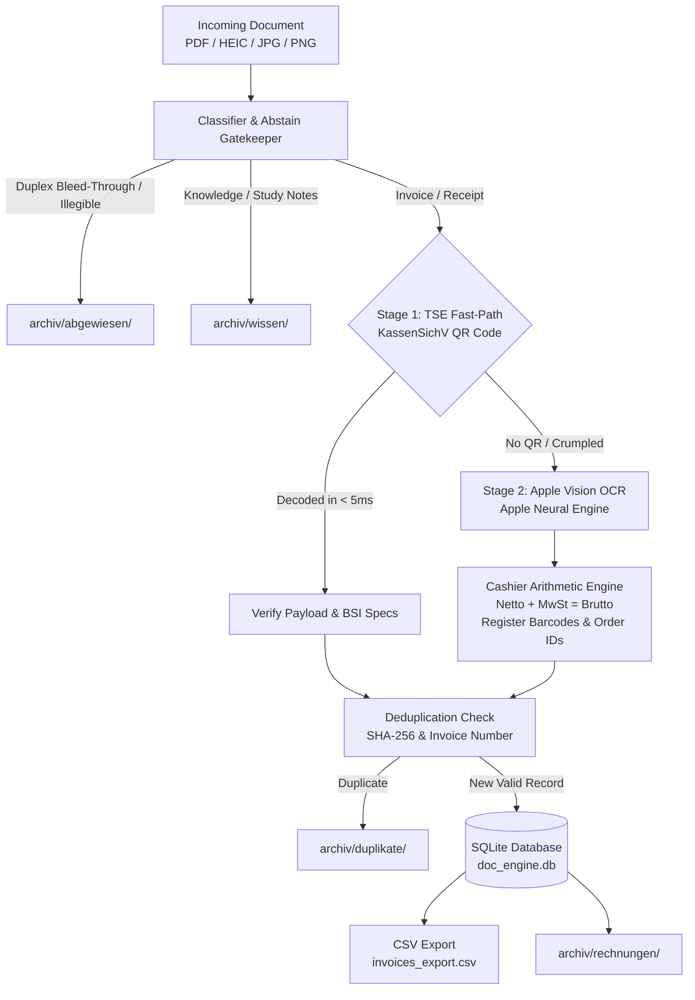

# doc_engine

[](https://www.python.org/)
[]()
[]()
[]()
[](https://opensource.org/licenses/MIT)

A high-performance, local-first document processing pipeline engineered for German cash register receipts (Kassenbons) and DIN A4 invoices. Runs 100% on-device on Apple Silicon (M1/M2/M3) using the native macOS Vision framework, mathematical validation, and GDPR-compliant local redaction.

---

## Architecture



---

## Background & Motivation

Most cloud-based document parsers rely on large vision-language models (VLMs) or external OCR APIs, introducing high latency (2–5s per page), recurring per-token costs, and severe GDPR compliance risks when handling sensitive corporate financial data.

In Germany, the **Cash Register Security Ordinance** (*KassenSichV / BSI TR-03153*) mandates that electronic cash registers print a cryptographically verifiable QR code containing transaction numbers, timestamps, tax breakdowns, and signatures.

`doc_engine` exploits this standard through a resilient **two-stage cascade**:
1. **Fast-Path (TSE / QR Code):** Decodes structured KassenSichV payloads directly via the macOS Vision framework in under 5 milliseconds with **0% OCR error rate**.
2. **Fallback (Neural Engine OCR + Arithmetic Engine):** For older cash registers, crumpled slips, or DIN A4 invoices without QR codes, the engine runs native OCR on the Apple Neural Engine, followed by an algebraic tax validator ($Netto + MwSt = Brutto$), multi-part order number extractors, and 22-digit register barcode parsers.
3. **Data Loss Prevention & Abstain Pattern:** Rejects unparseable or blank duplex-scanner bleed-through pages without data loss, archiving them safely to `archiv/abgewiesen/`.

---

## Fleet Benchmark

Benchmarked on an **Apple M1 Mac mini (16 GB)** across a fleet of real-world crumpled thermal receipts, supermarket slips (EDEKA, Lidl, Kaufland, Penny, HIT), travel tickets, and invoices:

| Metric | Benchmark Result |
|---|---|
| **Total Test Fleet** | **54 documents** (HEIC, JPG, PNG, PDF) |
| **Accuracy** | **54 / 54 passed (100% pass rate, 0 failures)** |
| **Total Fleet Runtime** | **5.75 seconds** (~106 ms / document) |
| **TSE Fast-Path Latency** | **< 5 ms** per receipt |
| **External API Calls** | **0** |
| **Cloud / Token Costs** | **0.00 €** |
| **GDPR / Data Privacy** | **100% on-device (Zero data leaves the machine)** |

---

## Requirements

* **macOS 12+** (Apple Silicon M1/M2/M3 recommended for Neural Engine hardware acceleration)
* **Python 3.10+**

---

## Installation

```bash
# Clone the repository
git clone https://github.com/KienCD-hash/doc_engine.git
cd doc_engine

# Set up virtual environment
python3 -m venv .venv
source .venv/bin/activate

# Install dependencies
pip install -r requirements.txt
```

---

## Usage

### 1. Ingest Documents
Drop incoming receipts or invoices (PDF, PNG, JPG, HEIC) into the `inbox/` directory:

```bash
cp /path/to/receipts/*.jpg inbox/
```

### 2. Run Pipeline
Execute the batch processor:

```bash
python main.py
```

Processed invoices are booked into `doc_engine.db`, exported to `invoices_export.csv`, and organized into clean archive directories.

### 3. Run Regression Test Suite
Run the fleet validation suite across all archived receipts:

```bash
python test_suite.py
```

### 4. Anonymize Sensitive Documents (GDPR / PII Redaction)
Black out names, IBANs, phone numbers, and cashier details before sharing or cloud storage:

```bash
# Redact a single document
python redactor.py invoice.jpg anonymized.jpg

# Batch redact an entire directory
python redactor.py inbox/ anonymisiert/
```

### 5. Utility: Split Multi-Page PDFs & Merge Receipts
Split scanned PDF batches into individual receipts, or merge booked receipts into a single tax export PDF:

```bash
# Split a multi-page scan batch into inbox/
python pdf_tools.py split batch_scan.pdf inbox/

# Merge all receipts into a single monthly PDF
python pdf_tools.py merge monthly_report.pdf archiv/rechnungen/
```

---

## Repository Structure

```text
doc_engine/
├── inbox/             # Drop folder for incoming documents
├── archiv/            # Automated archive storage
│   ├── rechnungen/    # Successfully booked invoices & receipts
│   ├── wissen/        # Extracted knowledge & study notes
│   ├── duplikate/     # Detected duplicate receipts
│   └── abgewiesen/    # Rejected / unparseable documents
├── main.py            # Batch orchestration and routing logic
├── tse.py             # KassenSichV / BSI TR-03153 QR-Code fast-path
├── extractor.py       # Native Apple Vision OCR & PDF rasterizer
├── parser.py          # German number normalizer & cashier arithmetic
├── classifier.py      # Document classifier and abstain gatekeeper
├── database.py        # SQLite storage and CSV export engine
├── redactor.py        # Automated GDPR / PII redaction (Apple Vision bboxes)
├── pdf_tools.py       # Multi-page PDF splitter & batch document merger
└── test_suite.py      # Regression test runner & fleet benchmark
```

---

## License

MIT License. Copyright (c) 2026 Duc Kien Chu.